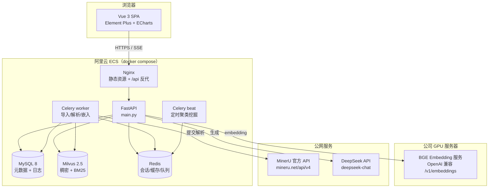
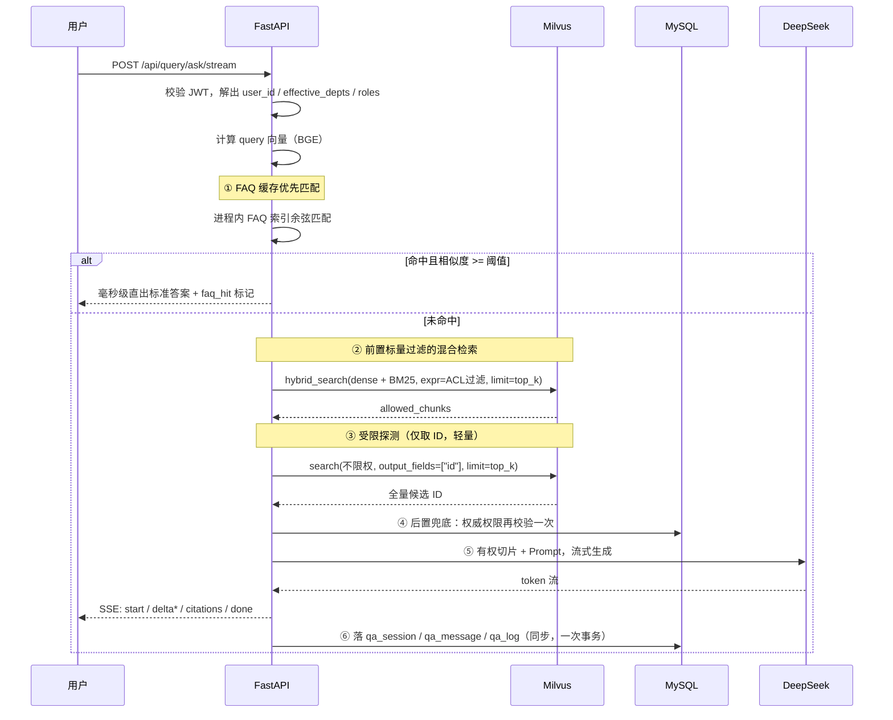
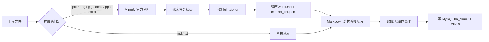
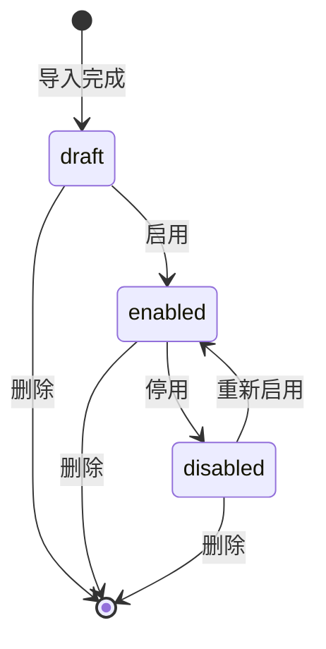
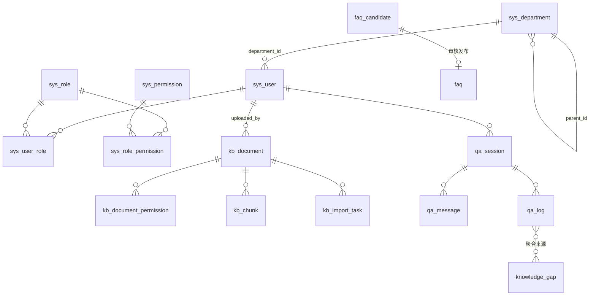

# RAG 知识库管理平台 — 产品需求与技术设计文档（PRD）

> 版本：v1.0　|　日期：2026-10-13　|　状态：待评审
> 需求来源：[需求分析.md](../需求分析.md) 第 2.9 节「知识库管理平台」
> 文档定位：本文件是后续开发的唯一事实来源（Single Source of Truth）。范围、契约、数据模型以本文为准；与原始需求文档冲突处，以本文「决策摘要」与「需求偏离说明」为准。

---

## 0. 决策摘要

下表全部由需求对齐访谈逐项确认，非默认值。实现时**不得**擅自改动；如需变更，先改本表再改代码。

| # | 维度 | 决策 | 备注 |
|---|------|------|------|
| D1 | 交付定位 | **生产上线**（公司内部，几十~几百人） | 安全、稳定、可维护优先于功能数量 |
| D2 | 前端 | Vue 3 + TypeScript + Vite + Pinia + Element Plus + ECharts | |
| D3 | 演示场景 | 2.9.9 两个场景**都做** | 需两套测试数据 |
| D4 | 生成模型 | DeepSeek API（`deepseek-chat`） | |
| D5 | 向量模型 | BAAI/bge-base-zh-v1.5（768 维） | 开发期指向本机 4060；生产期指向公司 GPU 服务器 |
| D6 | 文档解析 | **MinerU 官方 API**（`mineru.net/api/v4`）→ Markdown | 自建 MinerU 作为备选，接口须可切换 |
| D7 | 元数据库 | MySQL 8.0 | |
| D8 | 向量库 | Milvus 2.5 standalone（稠密 + BM25 稀疏） | |
| D9 | 缓存 / 队列 / 定时 | Redis + Celery（worker + beat） | |
| D10 | 部门权限语义 | **向下继承**：授权「财务部」= 财务部及其全部子孙部门可见 | |
| D11 | 账号体系 | 自建账号 + JWT（access + refresh）+ argon2 密码哈希 + RBAC | 不对接 SSO |
| D12 | 检索鉴权时机 | **前置标量过滤 + 后置兜底** | 见 §6.2 |
| D13 | 切片策略 | **Markdown 结构感知切分**（标题层级优先，长度兜底） | 见 §6.4 |
| D14 | 部署形态 | 全量 docker compose（阿里云 ECS 单机） | |
| D15 | 本地开发 | 直连阿里云数据库，靠**安全组 IP 白名单**放行 | 见 §11.3 风险 R2 |
| D16 | 生命周期 | 状态开关（草稿 / 启用 / 停用 / 软删除），**不做内容版本管理** | |
| D17 | GPU 服务 | 公司 GPU 服务器**只跑 BGE embedding**；MinerU 走官方 API | 显存压力的 OCR/版面分析交给 MinerU 云端 |

---

## 1. 项目目标

构建一个集**知识多源维护、四维细粒度权限鉴权、AI 鉴权检索问答、数据运营看板、知识自动沉淀**于一体的知识库管理平台。

一句话概括核心差异点：**这是一个「权限感知」的 RAG 系统**——不是先检索再假装过滤，而是在向量检索阶段就把无权内容挡在候选集之外，同时保留应用层兜底防止越权。

### 交付物

| 交付物 | 说明 |
|---|---|
| 前端控制台 | Vue 3 SPA，6 个业务页面 |
| 后端服务 | FastAPI + Celery，覆盖认证、组织、导入、检索、挖掘五域 |
| 向量化与大模型适配层 | EmbeddingClient / LLMClient / MinerUClient，均为可配置的远程调用 |
| 示例知识库测试数据集 | 覆盖 §9 两个业务场景 |
| 端到端演示链路 | 两个场景各一条，可现场走查 |

---

## 2. 范围边界

### 2.1 本期做（按三期递进，见 §10）

- 完整覆盖 2.9.10 全部 9 条验收标准。
- 覆盖 2.9.9 两个业务场景。

### 2.2 本期明确不做

| 不做项 | 原因 |
|---|---|
| 扫描件 OCR（在自有服务内） | 已由 MinerU 云端承担，本地不再引入 PaddleOCR |
| 知识单元内容版本管理 / 回滚 | D16 决策为状态开关 |
| 对接钉钉 / 企业微信 / LDAP SSO | D11 决策为自建账号 |
| 多租户隔离 | 单公司内部部署，无此需求 |
| 知识图谱、实体抽取 | 原始需求未提及 |
| 移动端适配 | 内部中后台，仅保证 1280px 以上桌面端 |

### 2.3 二期候选（不在本期承诺）

内容版本管理、deny（排除）权限规则、SSO 对接、ES 替换 BM25、离线评测集与召回指标看板。

---

## 3. 角色与权限矩阵

### 3.1 角色定义

| 角色 | 职责 | 核心菜单 |
|---|---|---|
| 普通用户 / 提问者 | 登录后用 AI 对话工作台提问，按被赋予的数据权限获取答案 | AI 问答工作台 |
| 知识管理员 | 文档导入 / 编辑 / 切片调整 / 删除、配置四维数据权限、审核发布 FAQ、处理知识缺口 | 问答工作台 + 知识维护与导入中心 + 知识沉淀与运营管理页 |
| 系统管理员 | 维护部门 / 角色 / 用户、分配功能与按钮权限、监控看板、配置模型参数 | 全部页面 + 组织架构与系统配置页 |

### 3.2 功能权限（RBAC）粒度

权限树分两层，落在 `sys_permission` 表：

- **菜单权限**：控制路由可见性（`type=menu`）。
- **按钮 / 操作权限**：控制页面内动作（`type=button`），如 `kb:document:delete`、`kb:permission:update`、`faq:candidate:publish`、`org:role:grant`。

前端通过 `v-permission` 指令隐藏无权限按钮；**后端每个写接口必须独立校验**，不得依赖前端隐藏。

### 3.3 数据权限（四维）与功能权限的关系

两者**正交**，缺一不可：

- 功能权限决定「你能进哪个页面、能点哪个按钮」。
- 数据权限决定「在 AI 问答里你能看到哪些知识单元的内容」。

> 注意：知识管理员管理文档台账时**不受数据权限约束**（否则无法维护），但**所有读取正文的动作写审计日志**。

---

## 4. 功能需求与验收映射

### 4.1 验收标准逐条映射

| # | 验收标准（原文摘要） | 承载模块 | 验证方式 | 期次 |
|---|---|---|---|---|
| A1 | 用户登录、部门树维护、角色管理、按钮级权限分配 | `service/org_service`、`core/security` | 建 3 层部门树 + 2 个角色，验证按钮隐藏与 403 | P1 |
| A2 | 单篇与批量导入，解析切片后完成检索入库 | `engines/import_engine` | 拖入 10 个文件，台账 chunk_count > 0，Milvus 可召回 | P1 |
| A3 | 知识单元增删改查 + 混合配置四维权限 | `engines/import_engine` | 4 种权限类型各配一次，权限弹窗回显正确 | P1 |
| A4 | 满足部门 / 角色 / 个人 / 全局任一权限即可访问 | `engines/search_engine` 前置过滤 | 4 组账号矩阵逐一验证放行 | P1 |
| A5 | AI 对话强制校验登录态并过滤未授权单元，输出权限缺失提示 | `engines/search_engine` | 场景一走查：普通业务员问高管薪酬 → 受限提示 | P1 |
| A6 | 看板展示访问次数、独立人数、知识单元数、常见问题榜、知识热度榜、Token 消耗、响应时间趋势 | `service/stats_service` | 造 200 条问答日志后核对大盘 | P2 |
| A7 | 自动挖掘高频问题生成推荐 FAQ，审核发布后写入缓存加速应答 | `engines/data_mining_engine`、`faq/` | 场景二走查：50+ 次提问 → 候选 → 发布 → 二次命中 | P3 |
| A8 | 自动识别未命中问题生成知识缺口列表，支持查看频次 | `engines/data_mining_engine` | 造未命中提问 → 缺口清单出现且频次正确 | P3 |
| A9 | 至少一个典型业务场景端到端全流程演示 | 全链路 | §9 两个场景各走一遍 | P1+P3 |

### 4.2 页面需求 → 前端路由

| 页面 | 路由 | 关键组件 |
|---|---|---|
| 登录页 | `/login` | 账号密码表单 + 图形验证码 |
| AI 智能问答工作台 | `/chat` | 会话侧边栏、消息流、SSE 渲染器、引用溯源卡片、权限缺失气泡 |
| 知识维护与导入中心 | `/kb/documents` | 台账表格（`el-table`）、导入抽屉（`el-upload` 拖拽）、解析进度、权限配置弹窗 |
| 知识沉淀与运营管理页 | `/kb/governance` | 三个 Tab：FAQ 候选审核 / 已发布 FAQ / 知识缺口清单 |
| 运营看板与数据大盘 | `/dashboard` | ECharts 折线 + 柱状 + 环形，TOP 榜表格 |
| 组织架构与系统配置页 | `/system` | 部门树（`el-tree`）、用户表格、角色权限树（`el-tree` + checkbox）、模型配置表单 |

---

## 5. 系统架构

### 5.1 组件拓扑



### 5.2 分层职责

| 层 | 目录 | 职责 | 禁止 |
|---|---|---|---|
| 路由层 | `backend/api/` | 参数校验、鉴权依赖注入、调用引擎、组装统一响应 | 禁止写业务逻辑与 SQL |
| 引擎层 | `backend/engines/` | 三个核心引擎的业务编排 | 禁止直接依赖 FastAPI |
| 服务层 | `backend/service/` | 组织、用户、审计、统计等横切服务 | — |
| 客户端层 | `backend/clients/` | 外部依赖封装（MinerU / Embedding / LLM / Milvus / Redis） | 禁止泄露第三方异常类型 |
| 模型层 | `backend/models/` | SQLAlchemy ORM | — |
| 契约层 | `backend/schemas/` | Pydantic DTO（请求 / 响应） | — |
| 任务层 | `backend/tasks/` | Celery 任务定义 | — |
| 核心层 | `backend/core/` | 配置、安全、依赖注入、异常处理、日志 | — |

> ✅ **已完成**：原目录 `banckend`（backend 的笔误）已改名为 `backend`，`main.py` 与各路由 docstring 的引用同步更新（原 §11.4 待确认项 O1）。

### 5.3 统一响应契约

所有接口统一返回：

```json
{ "code": 0, "message": "ok", "data": {} }
```

- `code = 0` 成功；非 0 业务错误（`1001` 参数错误 / `2001` 未登录 / `2002` 无功能权限 / `3001` 资源不存在 / `5000` 服务内部错误）。
- HTTP 状态码语义化：`200` 成功、`400` 参数错误、`401` 未认证、`403` 无权限、`404` 不存在、`500` 服务端异常。
- 分页统一 `{ "list": [], "total": 0, "page": 1, "page_size": 20 }`。

---

## 6. 核心机制设计

### 6.1 四维数据权限模型

#### 6.1.1 存储

知识单元的权限实体独立成表 `kb_document_permission`，一行一个授权实体：

| 字段 | 说明 |
|---|---|
| `document_id` | 知识单元 ID |
| `entity_type` | `global` / `department` / `role` / `user` |
| `entity_id` | 部门 ID / 角色 ID / 用户 ID；`global` 时固定为 `*` |

**默认无任何权限**：知识单元创建后若未配置任何权限行，则除知识管理员外的所有人都无法在问答中检索到它。

#### 6.1.2 判定规则（OR 充分条件）

用户可读知识单元 ⟺ 满足以下任一条：

1. 该知识单元存在 `entity_type='global'` 的权限行；
2. `用户有效部门集合 ∩ 授权部门集合 ≠ ∅`；
3. `用户角色集合 ∩ 授权角色集合 ≠ ∅`；
4. `用户 ID ∈ 授权用户集合`。

其中**用户有效部门集合**（D10 向下继承语义）：

```
effective_depts(u) = { dept(u) } ∪ ancestors(dept(u))
```

> 推导：因为用户的部门集合包含**所有祖先**，而授权是按部门精确集合求交，所以「授权财务部」自动等于「财务部及其全部子孙可见」——子孙部门的用户，其 `effective_depts` 包含财务部。
> `ancestors()` 通过 `sys_department.path` 物化路径（如 `/1/4/9/`）一次 SQL 查出，不做递归。

#### 6.1.3 权限缓存与失效

- 用户登录时计算一次 `effective_depts` + `roles`，写入 JWT 载荷与 Redis（TTL = access token 有效期）。
- 部门 / 角色 / 用户关系变更时，**主动删除**受影响用户的 Redis 缓存键；JWT 依赖短有效期（30 min）自然过期，不做黑名单。
- 知识单元权限变更时，必须同步刷新 Milvus 中该文档全部 chunk 的 ACL 标量字段（见 §6.2.2）。

### 6.2 AI 鉴权检索与问答

#### 6.2.1 完整链路



#### 6.2.2 前置标量过滤（D12）

Milvus collection `kb_chunk` 的 schema（关键字段）：

| 字段 | 类型 | 说明 |
|---|---|---|
| `id` | VARCHAR (PK) | chunk 主键 |
| `document_id` | VARCHAR | 所属知识单元 |
| `content` | VARCHAR, `enable_analyzer=True`, `analyzer_params={"type":"chinese"}` | 正文，供 BM25 使用 |
| `heading_path` | VARCHAR | 标题路径，如 `差旅制度 > 报销标准 > 住宿费` |
| `dense` | FLOAT_VECTOR(768) | BGE 稠密向量 |
| `sparse` | SPARSE_FLOAT_VECTOR | 由 BM25 Function 自动生成 |
| `acl_global` | BOOL | 是否全局公开（冗余副本） |
| `acl_departments` | ARRAY\<VARCHAR\> | 可见部门 ID 列表 |
| `acl_roles` | ARRAY\<VARCHAR\> | 可见角色 ID 列表 |
| `acl_users` | ARRAY\<VARCHAR\> | 可见用户 ID 列表 |

检索表达式（由用户上下文动态拼接）：

```python
expr = (
    f"acl_global == true"
    f" or array_contains_any(acl_departments, {depts})"
    f" or array_contains_any(acl_roles, {roles})"
    f" or array_contains_any(acl_users, ['{uid}'])"
)
```

混合检索本体：

```python
from pymilvus import AnnSearchRequest, RRFRanker

reqs = [
    AnnSearchRequest(data=[query_dense], anns_field="dense",
                     param={"metric_type": "COSINE", "params": {"ef": 64}},
                     limit=top_k * 3, expr=expr),
    AnnSearchRequest(data=[query_text], anns_field="sparse",
                     param={"metric_type": "BM25"},
                     limit=top_k * 3, expr=expr),
]
results = client.hybrid_search(collection, reqs, RRFRanker(k=60),
                               limit=top_k, output_fields=[...])
```

> 两个子检索的 `limit` 取 `top_k * 3` 再交给 RRF 融合，避免融合后候选过少。

#### 6.2.3 后置兜底（防越权）

Milvus 的 ACL 字段是**冗余副本**，存在与 MySQL 权威权限不同步的窗口。因此检索结果返回后，必须：

1. 用 MySQL 中 `kb_document_permission` 的权威数据对每个候选 chunk 的 `document_id` 复核一次；
2. 复核不通过的**从上下文剔除、从引用列表剔除**；
3. 记录到 `qa_log.blocked_ids`，并触发告警日志（说明索引与权威数据不一致，需排查同步链路）。

这是「严禁越权泄漏」的硬保证，**不可省略**。

#### 6.2.4 权限缺失提示（信息泄漏的取舍）

需求要求回答中标注「部分参考资料因权限受限无法展示」。实现与安全取舍：

- 受限探测检索与放行检索的结果做差集，得到 `blocked_count`。
- **默认只输出数量**：`检测到 N 篇相关文档因权限受限无法展示`。**不返回标题、不返回正文。**
- 提供配置开关 `ACL_REVEAL_BLOCKED_TITLES`（默认 `false`）。开启后才附带受限文档标题——这会泄漏「存在某份敏感文档」这一事实，仅在演示场景需要时打开。
- 探测检索只取 `id` 字段，成本可控；结果按 `(user_id, query_hash)` 缓存 60 秒，避免多轮对话中重复开销。

#### 6.2.5 SSE 流式契约

保持现有路由注释中已定义的事件序列：

| 事件 | 载荷 | 说明 |
|---|---|---|
| `start` | `{session_id, message_id}` | 首帧，前端据此建立消息气泡 |
| `delta` | `{content}` | 增量文本分片，可能多帧 |
| `citations` | `{items: [{document_id, title, chunk_id, heading_path, score}]}` | 引用溯源列表 |
| `blocked` | `{count, titles?}` | 权限受限提示 |
| `done` | `{latency_ms, token_in, token_out, faq_hit, llm_called}` | 结束帧，附带统计。`llm_called` 让前端能区分「FAQ 直出」与「模型正常应答但产出 0 token」（字典 §9 #107） |
| `error` | `{code, message}` | 异常终止 |

> `blocked` 事件排在 `citations` 之后、`done` 之前。
>
> ✅ **已定（2026-10-14）**：`done` 增 `llm_called: bool`（见 `P1-11-be-search-qa`）。
> 起因是原型要显示「未调用生成模型」，而原 4 个字段推不出来——前端只能用
> `token_out === 0 && !faq_hit` 推断，在「模型正常应答但恰好产出 0 token」时**误报**。
> 本表与字典 §7 已同步。

前端实现注意：**必须用 `fetch` + `ReadableStream` 消费 SSE，不能用 `EventSource`**——后者只支持 GET，无法携带 POST body 与 `Authorization` 头。

### 6.3 知识沉淀闭环

#### 6.3.1 FAQ 聚类挖掘

Celery beat 每日 02:00 触发 `mine_faq_clusters`：

1. 取窗口内（默认近 7 天）`qa_log` 中 `faq_hit = false` 的提问。
2. 用 BGE 计算问题向量（可复用问答时已算的向量，落库缓存）。
3. 聚类：余弦相似度 ≥ `FAQ_CLUSTER_SIMILARITY`（默认 0.85）的提问归入同一簇。内部规模下用并查集即可，避免引入 HDBSCAN 的调参负担。
4. 簇内频次 ≥ `FAQ_MIN_FREQUENCY`（默认 5）→ 生成候选 FAQ：
   - 代表性提问 = 距质心最近的问题；
   - 推荐标准答案 = 取簇内 `qa_log` 中最高相似度那次回答的 LLM 输出，调一次 DeepSeek 做「合并去重为一条标准答案」；
   - `confidence` = 簇内平均相似度 × 频次归一化。
5. 写入 `faq_candidate`，状态 `pending`。

#### 6.3.2 FAQ 缓存加速

- 管理员审核通过 → 写 `faq` 表（`cache_enabled=true`）→ 发布 Redis 频道 `faq:changed`。
- 每个 API / worker 进程维护一份**进程内 numpy 索引**（`faq/faq_cache.py`）：
  - 启动时从 Redis 全量加载已启用 FAQ 的 `(id, question_embedding, answer)`；
  - 订阅 `faq:changed` 做增量刷新；
  - 内部规模下 FAQ 量级为几百~几千条 × 768 维 ≈ 数 MB，矩阵乘法匹配耗时 < 2 ms，满足「毫秒级直出」。
- 匹配阈值 `FAQ_MATCH_THRESHOLD`（默认 0.92）。命中即直接返回标准答案，**不调用 LLM**，`qa_log.faq_hit = true`。

> 不使用 Redis 向量检索（需 RediSearch 模块）——需求写明的是「内存缓存」，进程内索引更贴切且零额外依赖。

#### 6.3.3 知识缺口识别

- 检索环节中满足下列任一条件的问题写入 `knowledge_gap`：
  - 前置过滤后 allowed_chunks 为空；
  - 最高相似度 < `KB_MIN_SCORE`（默认 0.4）。
- 按问题向量相似度聚合（阈值同 6.3.1），累加 `frequency`，更新 `last_seen_at`。
- `suggested_category` 由 DeepSeek 依据问题文本推荐一个分类（可选，失败则留空）。
- 前端支持「一键转建知识补充任务」：生成一条 `kb_import_task`（`type=supplement`）并跳转导入中心。

> 🔧 **2026-10-14 修订（落地 be-09 时对账发现，见字典 §9 #142）**
>
> 上面第一条的「前置过滤后 `allowed_chunks` 为空」**照字面实现是错的**。
> be-05 落库的口径是：`allowed_ids` = **后置复核准入**的候选（`retrieval.py:282`），
> `top_score` 也只统计准入集合（`retrieval.py:268`）。于是该条件会把两类
> **不是知识缺口**的情况算成缺口，且不报错：
>
> 1. **FAQ 缓存直接作答的提问** —— 该路径根本没检索，`allowed_ids` 天然为空
>    ⇒ 每一条被 FAQ 答上的提问都会进缺口池，而 FAQ 恰恰最不可能是知识缺口；
> 2. **检索到了、但候选全被权限挡住** —— 知识存在，缺的是**权限**。
>    算成缺口会让运营去补一份已经存在的材料，并把「本部门不该看到的话题」
>    以提问文本的形式堆进治理页。
>
> **因此判据收窄为**（be-09 §4.2）：
>
> ```
> faq_hit                  → 不是缺口（本轮没检索，无从判断）
> 召回集为空                → 是缺口   ← 原「前置过滤后 allowed_chunks 为空」收窄到这里
> allowed_ids 为空          → 不是缺口（有候选但全被权限挡住 ⇒ 缺权限，不是缺知识）
> top_score < KB_MIN_SCORE → 是缺口
> ```
>
> 被排除的第 2 类**不丢弃**，计入聚合日志 `skipped_by_acl` —— 它是「某部门权限配少了」
> 的强信号，值得运营看见，只是处置动作是**调权限**而非补料，故不入缺口池。

### 6.4 文档解析与切片

#### 6.4.1 解析链路（D6）



MinerU 调用要点（已核实官方 v4 契约）：

| 项 | 值 |
|---|---|
| 提交 | `POST https://mineru.net/api/v4/...`，`Authorization: Bearer <token>` |
| 限制 | 单文件 ≤ 200 MB；批量 ≤ 50 个 |
| 状态机 | `pending → running → converting → done`（另有 `waiting-file`） |
| 结果 | 完成态返回 `full_zip_url`，**不回正文**，必须下载解压 |
| 产物 | `full.md`、`*_content_list.json`、`layout.json` 等 |

实现要求：

- 提交后进入轮询（指数退避，首次 3 s，上限 30 s，总超时 15 min），轮询在 Celery 任务内进行，不占用 API 进程。
- **zip 解压必须做路径穿越防护**（拒绝含 `..` 或绝对路径的条目）与解压体积上限校验。
- 下载的临时文件与解压目录放在独立临时目录，任务结束即清理。
- MinerU 调用失败要区分「可重试」（网络 / 5xx / 限流）与「不可重试」（格式不支持 / 文件损坏），前者 Celery 重试 3 次（退避 60/300/900 s）。

#### 6.4.2 结构感知切片（D13）

```
输入：full.md
步骤：
1. 按 Markdown 标题（#/##/###）切分为语义块，维护 heading_path 栈
   （如 "差旅制度 > 报销标准 > 住宿费"）
2. 每个语义块内：
   - 若 token 数 <= CHUNK_MAX_TOKENS(512)  → 整块成一片
   - 若超出                                  → 按段落切，带 CHUNK_OVERLAP(64) 重叠
3. 表格（连续 | 行）整体保留，超长表格按行分组，但每组重复表头
4. 代码块整体保留，不切
5. 丢弃 token < CHUNK_MIN_TOKENS(32) 的碎片，合并入相邻片
6. 每片写入：content、heading_path、chunk_index、token_count
```

`heading_path` 的双重作用：① 作为 BM25 检索的额外召回信号；② 直接用于前端引用溯源卡片的定位面包屑。

### 6.5 知识单元生命周期（D16）

状态机：



- 只有 `enabled` 状态的知识单元参与检索（前置过滤表达式中追加 `status == 'enabled'`，或在应用层先过滤 document_id）。
- **删除为软删除**（`deleted_at`），同时异步清理 Milvus 中对应的全部 chunk 与 MySQL 的 `kb_chunk` 行；Milvus 删除失败进入重试队列并告警。
- 编辑正文 → 全量重建该文档的切片与向量（增量切片在 P1 不做，避免复杂度）。

---

## 7. 数据模型

### 7.1 ER 总览



### 7.2 表结构

#### 组织与权限

| 表 | 关键字段 |
|---|---|
| `sys_department` | `id`、`name`、`parent_id`、`path`(物化路径 `/1/4/9/`)、`sort`、`status`、`created_at`　**索引**：`path` |
| `sys_user` | `id`、`username`(唯一)、`password_hash`、`real_name`、`department_id`、`email`、`status`、`last_login_at`、`created_at` |
| `sys_role` | `id`、`code`(唯一)、`name`、`description`、`is_builtin`、`created_at` |
| `sys_user_role` | `user_id`、`role_id`（联合主键） |
| `sys_permission` | `id`、`parent_id`、`code`(唯一)、`name`、`type`(menu/button)、`path`、`sort` |
| `sys_role_permission` | `role_id`、`permission_id`（联合主键） |
| `sys_audit_log` | `id`、`user_id`、`action`、`target_type`、`target_id`、`detail`(JSON)、`ip`、`created_at`　**索引**：`(user_id, created_at)` |

#### 知识库

| 表 | 关键字段 |
|---|---|
| `kb_document` | `id`、`title`、`file_name`、`file_type`、`category`、`status`(draft/enabled/disabled)、`source_markdown`(LONGTEXT)、`chunk_count`、`uploaded_by`、`created_at`、`updated_at`、`deleted_at` |
| `kb_document_permission` | `id`、`document_id`、`entity_type`(global/department/role/user)、`entity_id`　**索引**：`document_id`、`(entity_type, entity_id)` |
| `kb_chunk` | `id`、`document_id`、`chunk_index`、`content`(TEXT)、`heading_path`、`token_count`、`created_at`　**索引**：`document_id` |
| `kb_import_task` | `id`、`batch_id`、`file_name`、`file_size`、`type`(upload/supplement)、`status`(pending/parsing/embedding/success/failed)、`progress`(0-100)、`total_chunks`、`mineru_task_id`、`error_msg`、`uploaded_by`、`created_at`、`finished_at` |

#### 问答与审计

| 表 | 关键字段 |
|---|---|
| `qa_session` | `id`、`user_id`、`title`(取首问前 20 字)、`message_count`、`created_at`、`updated_at` |
| `qa_message` | `id`、`session_id`、`role`(user/assistant)、`content`、`citations`(JSON)、`blocked_count`、`created_at` |
| `qa_log` | `id`、`session_id`、`user_id`、`department_id`、`question`、`question_embedding`(BLOB)、`recalled_ids`(JSON)、`allowed_ids`(JSON)、`blocked_ids`(JSON)、`top_score`、`token_in`、`token_out`、`latency_ms`、`faq_hit`(BOOL)、`created_at`　**索引**：`(created_at)`、`(user_id, created_at)` |

> `qa_log.question_embedding` 落库是为聚类挖掘复用，避免重复调用 BGE。768 × float32 = 3 KB/条，量级可控。

#### 沉淀运营

| 表 | 关键字段 |
|---|---|
| `faq_candidate` | `id`、`cluster_key`、`question`、`answer`、`frequency`、`confidence`、`related_doc_ids`(JSON)、`status`(pending/published/rejected)、`reviewed_by`、`reviewed_at`、`created_at` |
| `faq` | `id`、`question`、`answer`、`question_embedding`(BLOB)、`cache_enabled`(BOOL)、`source_candidate_id`、`published_by`、`published_at`、`hit_count`　**索引**：`cache_enabled` |
| `knowledge_gap` | `id`、`question`、`question_embedding`(BLOB)、`department_id`、`frequency`、`max_score`、`suggested_category`、`status`(open/tasked/closed)、`last_seen_at`、`created_at` |

### 7.3 迁移

使用 **Alembic** 管理 schema 变更，所有建表通过 migration 生成，禁止手写 DDL 后补 migration。

---

## 8. API 契约

### 8.1 认证与组织（新增）

| 方法 | 路径 | 说明 | 权限 |
|---|---|---|---|
| POST | `/api/auth/login` | 账号密码登录，返回 access + refresh token | 公开 |
| POST | `/api/auth/refresh` | 刷新 access token | 公开（校验 refresh） |
| POST | `/api/auth/logout` | 登出，清 Redis 会话缓存 | 登录 |
| GET | `/api/auth/me` | 当前用户信息 + 部门（自身 + 有效部门集合及其名称）+ 角色 + 权限码列表 | 登录 |
| GET | `/api/org/departments/tree` | 部门树 | 登录 |
| POST/PUT/DELETE | `/api/org/departments[/{id}]` | 部门增改删 | `org:department:*` |
| GET | `/api/org/users` | 用户分页列表 | `org:user:list` |
| POST/PUT/DELETE | `/api/org/users[/{id}]` | 用户增改删 | `org:user:*` |
| PUT | `/api/org/users/{id}/roles` | 分配角色 | `org:user:grant` |
| GET | `/api/org/roles` | 角色列表 | `org:role:list` |
| POST/PUT/DELETE | `/api/org/roles[/{id}]` | 角色增改删 | `org:role:*` |
| GET | `/api/org/permissions/tree` | 功能权限树 | `org:role:list` |
| PUT | `/api/org/roles/{id}/permissions` | 角色授权 | `org:role:grant` |

> ⚠️ **上表「权限」列里的 `*` 是「示意多个动作」的简写，不是字面权限码。**
> 实际权限码一律以 [核心数据字典.md](核心数据字典.md) **§5.6** 为准 ——
> `org:department:*` / `org:user:*` / `org:role:*` 已**作废**，展开为 13 条独立码
> （`org:department:create|update|delete`、`org:user:list|create|update|delete|grant`、
> `org:role:list|create|update|delete|grant`）。
> 直接按 `*` 字面种 `sys_permission` 的后果是**前端按钮对所有人（含 `sys_admin`）静默不可见**，
> 且前后端都不报错。三处（字典 §5.6 / 后端种子 / 前端 `PERM` 常量）必须逐字一致。

**JWT 设计**

| 项 | 值 |
|---|---|
| 算法 | HS256（`JWT_SECRET` 来自环境变量） |
| access token | 30 min，载荷 `{sub, username, depts, roles, perms, exp}` |
| refresh token | 7 天，仅存 `{sub, jti, exp}`，jti 落 Redis 支持主动吊销 |
| 密码哈希 | `pwdlib[argon2]` |
| 登录防爆破 | 同账号连续失败 5 次锁 15 min（Redis 计数） |

### 8.2 知识导入（沿用现有路由，补实现）

保持 [import_router.py](../backend/api/import_router.py) 已定义的 6 个端点不变，补充：

| 方法 | 路径 | 说明 |
|---|---|---|
| GET | `/api/import/tasks` | 任务列表（批量导入进度总览，前端抽屉轮询用） |
| POST | `/api/import/tasks/{id}/retry` | 失败任务重试 |
| PUT | `/api/import/documents/{id}` | 编辑知识单元（标题/分类/正文） |
| PUT | `/api/import/documents/{id}/status` | 启用 / 停用 |

### 8.3 检索问答（沿用现有路由，补实现）

保持 [query_router.py](../backend/api/query_router.py) 已定义的 5 个端点不变。补充：

| 方法 | 路径 | 说明 |
|---|---|---|
| GET | `/api/query/sessions` | 当前用户会话列表（历史侧边栏） |
| GET | `/api/query/suggestions` | 智能联想提问（基于 FAQ + 高频问题） |

> 注意：现有 `SearchRequest` / `AskRequest` 中的 `user_context` 由客户端传入。**这是安全隐患**——客户端可伪造 `user_id` 与 `role_ids` 越权。实现时必须改为**从 JWT 解析**，`user_context` 字段保留但从服务端覆盖（见 §11.3 R3）。

### 8.4 数据挖掘与沉淀（沿用现有路由）

保持 [data_mining_router.py](../backend/api/data_mining_router.py) 已定义的 8 个端点不变。

### 8.5 运营看板（新增）

| 方法 | 路径 | 请求参数 | 说明 |
|---|---|---|---|
| GET | `/api/stats/dashboard/overview` | `start_time?` `end_time?` | 卡片指标：PV、UV、知识单元总数、今日提问量、FAQ 命中率（+ 命中条数 / 权限拦截数 / 覆盖率 / 平均与 P95 延时 / 生效窗口回显） |
| GET | `/api/stats/dashboard/trend` | `granularity?`(=day) `start_time?` `end_time?` | 趋势：Token 消耗、提问量、平均响应时长（按日/小时）。**一次返回全部指标** |
| GET | `/api/stats/dashboard/top-questions` | `start_time?` `end_time?` `limit?`(=10) | 高频问题 TOP 榜 |
| GET | `/api/stats/dashboard/top-knowledge` | `start_time?` `end_time?` `limit?`(=10) | 高频引用知识 TOP 榜 |
| GET | `/api/stats/dashboard/latency` | `start_time?` `end_time?` | 响应延时分布直方图（+ 平均 / P95） |
| GET | `/api/stats/audit-logs` | 见 §8.1 `audit-logs` | 审计流水（分页 + 筛选） |

**请求参数口径（✅ 2026-10-14 冻结，回填自 `P2-13-be-stats` §4.1 / 全局 #77）**：

- 时间参数格式 `YYYY-MM-DD HH:mm:ss`（亦接受 `YYYY-MM-DD`），**naive Asia/Shanghai**；
  不传时默认近 7 天（`STATS_DEFAULT_RANGE_DAYS`）。响应**回带生效后的窗口**。
- `granularity=hour` 只允许查近 7 天，超窗返回 1001。
- `limit` 默认 10、上限 `STATS_TOP_N`(50)。
- **无数据返回零值 / 空数组，不返回 404**（看板允许空态）。

看板聚合走**预聚合表**：Celery beat 每 10 分钟把 `qa_log` 汇总进 `stats_hourly` / `stats_daily`（§7.2 字段见字典 §2.5），看板只查聚合表，避免大表实时扫描。除 `overview` 的「知识单元总数」外，5 个端点**不得触碰 `qa_log`**。

---

## 9. 示例业务场景与测试数据

两个场景都需构造数据集，放在 `fixtures/` 目录。

### 9.1 场景一：跨部门财务与薪酬制度问答隔离

**测试数据**

| 文件 | 格式 | 权限配置 |
|---|---|---|
| 差旅报销标准.pdf | PDF | `global` |
| 高管薪酬与股权激励细则.docx | Word | `department: 人力资源部` + `role: 管理层` |
| 采购付款审批流程.md | Markdown | `department: 财务部` |
| 员工手册.txt | TXT | `global` |
| 部门预算编制指引.pdf | PDF | `department: 财务部` + `user: <指定人>` |

**组织数据**：集团总部 → {财务部 → {成本组}}、人力资源部、客服部

**验证矩阵（对应验收 A4 / A5）**

| 账号 | 所属 | 问「差旅报销标准」 | 问「高管薪酬规则」 |
|---|---|---|---|
| 客服专员 | 客服部 | ✅ 正常召回 + 溯源 | 🚫 受限提示，无正文 |
| 财务成本组会计 | 财务部/成本组 | ✅ | 🚫 受限提示 |
| HR 专员 | 人力资源部 | ✅ | ✅ 正常召回 |
| 管理层成员 | 任意部门 + 管理层角色 | ✅ | ✅（角色命中） |

> 成本组会计能检索到「采购付款审批流程」，**正是 D10 向下继承语义的验证点**。

### 9.2 场景二：客服高频退换货沉淀与缺口补足

**测试数据**

| 数据 | 内容 |
|---|---|
| 知识文档 | 售后政策说明书（含退换货条款）、生鲜配送说明、常见问题（不含海外直邮清关） |
| 提问日志 | 预置 60 条「生鲜食品破损如何申请退款」的变体提问（用于触发聚类阈值 5）、30 条「海外直邮保税仓清关延误怎么办」（应全部未命中，进缺口池） |

**验证路径（对应验收 A7 / A8）**

1. 手动触发 `POST /api/mining/faq/mine` → 候选列表出现该问题簇，频次 ≥ 50。
2. 管理员审核润色 → 发布 → 写缓存。
3. 再次提同义问题 → `qa_log.faq_hit = true`，响应 < 100 ms，**未调用 DeepSeek**（通过 token 消耗为 0 验证）。
4. 缺口清单出现「海外直邮保税仓清关延误」相关条目，频次正确。
5. 一键转建 → 导入对应说明文档 → 再次提问命中。

---

## 10. 三期里程碑

### P1 — 主干闭环（对应验收 A1-A5、A9-场景一）

| 交付 | 内容 |
|---|---|
| 基础设施 | docker compose（MySQL/Milvus/Redis）、Alembic 初始化、settings、日志、统一异常 |
| 认证组织 | 登录 / JWT / RBAC / 部门树 / 用户 / 角色 / 权限树 + 前端组织页 |
| 知识导入 | MinerUClient、结构感知切片、BGE 向量化、Milvus 写入、台账 CRUD、权限配置、导入抽屉 |
| 检索问答 | 前置过滤混合检索、后置兜底、SSE 问答、对话工作台、引用溯源卡片、权限缺失提示 |
| 验收 | 场景一可完整走查 |

**出口标准**：一个新用户拿到仓库，`docker compose up -d` + 造数脚本，能在浏览器里跑通「登录 → 导入 → 配权限 → 提问 → 看到受限提示」。

### P2 — 运营与审计（对应验收 A6）

| 交付 | 内容 |
|---|---|
| 审计 | `qa_log` 全字段落库、`sys_audit_log` 写操作留痕、审计查询页 |
| 看板 | `stats_hourly`/`stats_daily` 预聚合、6 个看板接口、ECharts 大盘页 |

### P3 — 知识自进化（对应验收 A7、A8、A9-场景二）

| 交付 | 内容 |
|---|---|
| 挖掘 | Celery beat 定时聚类、候选 FAQ 生成 |
| 缓存 | 进程内 FAQ 索引 + Redis 变更通知 + 毫秒级直出 |
| 缺口 | 缺口池、聚合、转建任务 |
| 前端 | 知识沉淀与运营管理页三个 Tab |
| 验收 | 场景二可完整走查 |

---

## 11. 部署、配置与风险

### 11.1 部署拓扑

`docker-compose.yml` 服务清单：

| 服务 | 镜像 | 说明 |
|---|---|---|
| `etcd` | `quay.io/coreos/etcd:v3.5.18` | Milvus 依赖 |
| `minio` | `minio/minio:RELEASE.2023-03-20T20-16-18Z` | Milvus 对象存储。**此版本自 Milvus v2.2.5 起固定，升级会导致 Milvus 异常** |
| `milvus` | `milvusdb/milvus:v2.5.27` | standalone，需 `security_opt: seccomp:unconfined` |
| `mysql` | `mysql:8.0` | 字符集 `utf8mb4`，初始化脚本挂载 `deploy/mysql/init/` |
| `redis` | `redis:7-alpine` | 强制 `--requirepass`，开启 AOF 持久化 |
| `api` | 自建 | FastAPI；宿主机端口仅绑 `127.0.0.1:8000`，仅供本机排障 |
| `worker` | 自建 | Celery worker，`--concurrency=2` |
| `beat` | 自建 | Celery beat |
| `nginx` | `nginx:alpine` | 托管前端静态资源 + 反代 `/api` |

**内存预算**：Milvus ~4G + MySQL ~1G + Redis ~0.3G + API/worker/beat ~1.5G + Nginx ~0.1G ≈ **7G**。故 ECS 至少 4核8G（见 R4）。

**关键 Nginx 配置**（SSE 必需）：

```nginx
client_max_body_size 512m;        # 批量导入单文件上限 200MB

location /api/ {
    proxy_pass http://api:8000;
    # 关掉缓冲，否则 delta 分片会被攒到最后一次性吐出，打字机效果失效
    proxy_buffering off;
    proxy_cache off;
    proxy_set_header X-Accel-Buffering no;
    proxy_request_buffering off;  # 大文件上传不先落盘
    proxy_read_timeout 300s;
}
```

### 11.2 环境变量

完整清单见仓库根目录的 [`.env.example`](../.env.example)——**它是唯一事实来源**，本节不再重复列举以免漂移。

两条约定：

1. **连接串由分段字段派生**，不在 `.env` 里配置 `DATABASE_URL` / `REDIS_URL` / `CELERY_*`。
   分段值与整串值不一致是经典事故，派生可以从结构上杜绝。派生逻辑见 `backend/core/settings.py`。
2. **`APP_ENV=production` 时强制自检**：`MYSQL_PASSWORD` / `JWT_SECRET`（≥32 位）/ `MINERU_API_TOKEN` / `DEEPSEEK_API_KEY` 任一缺失或仍为默认值，应用**拒绝启动**。宁可起不来，也不要带着默认 JWT 密钥上线。

### 11.3 风险清单

| # | 风险 | 影响 | 缓解 |
|---|---|---|---|
| **R1** | **MinerU 官方 API 导致文档出境** | 公司内部制度文档（含「高管薪酬与股权激励细则」这类敏感件）上传至第三方站点。合规风险高 | ① 上线前须经公司合规确认；② `MinerUClient` 必须做成可切换实现，保留自建 MinerU（公司 GPU 服务器）的改造路径；③ 可选：对高密级文档走自建通道 |
| **R2** | 本地直连阿里云数据库，靠安全组 IP 白名单 | 换网络即断连；白名单过宽则等同暴露 | 优先改用 SSH 隧道；白名单**只放行单个 /32**；数据库密码一律走 `.env`，不入仓库 |
| **R3** | 现有 `AskRequest.user_context` 由客户端传入 | **越权漏洞**：伪造 `user_id`/`role_ids` 即可读取任意知识单元 | 实现时强制从 JWT 解析用户上下文并覆盖请求体字段；`user_context` 字段在 P1 结束前从契约中移除 |
| **R4** | ECS 规格未确认 | 假设 4C8G。Milvus standalone 自身需 ~4G，加 MySQL/Redis/Celery/API 会 OOM | **待你确认**（§11.4 O2）。若为 2C4G，需将 Milvus 迁至独立机器或改用 Milvus Lite 过渡 |
| **R5** | 「生产上线」与「三期递进」的张力 | P1 结束时功能仅覆盖验收 5/9 条，若被要求一次性验收则来不及 | 排期前明确各期验收节点 |
| **R6** | Milvus ACL 字段与 MySQL 权威权限不同步 | 越权泄漏 | §6.2.3 后置兜底 + 同步失败告警 + 定期对账任务 |
| **R7** | 前端渲染 LLM 输出的 Markdown | XSS（模型输出或知识正文中嵌入恶意 HTML） | 必须用 `DOMPurify` 清洗后再 `v-html`；禁止直接渲染 |
| **R8** | 集群挖掘的相似度阈值难调 | 阈值过高无候选、过低产生垃圾 FAQ | 阈值入配置；管理页展示候选置信度便于人工判断；P3 前用场景二数据校准 |
| **R9** | 权限缺失提示本身泄漏「存在敏感文档」 | 信息侧信道 | 默认只报数量不报标题（§6.2.4）；该行为写入审计日志 |
| **R10** | Milvus 依赖 Docker，而你本机无 Docker | 本地完全无法离线开发 | 已决策直连云端（D15）。若云上 Milvus 故障，本地无降级路径 |

### 11.4 待确认项

| # | 事项 | 需要的输入 |
|---|---|---|
| ~~O1~~ | ~~目录 `banckend` 改名 `backend`~~ | ✅ 已完成 |
| **O2** | ECS 的 CPU / 内存 / 磁盘 / 系统版本 | 直接决定 compose 资源配置与 Milvus 能否同机 |
| **O3** | 公司 GPU 服务器上 BGE 服务如何部署、是否已有 OpenAI 兼容端点 | 决定 `EmbeddingClient` 是调用现成服务还是需要一并交付部署脚本 |
| **O4** | ECS 与 GPU 服务器之间的网络是否可达 | 若跨公网，需评估调用延迟与安全（加白名单或走内网） |
| **O5** | MinerU API Token 的配额与计费方式 | 影响批量导入的并发策略与限流 |
| **O6** | 公司合规对文档出境的结论（对应 R1） | 若不允许，D6 需改为自建 MinerU，工作量与 GPU 显存需求均上升 |

---

## 12. 关键技术选型依据

| 选型 | 为什么是它 |
|---|---|
| Milvus 原生 BM25 而非 ES | 稠密 + 稀疏 + RRF 融合在 Milvus 内一次完成，省掉一个 2GB+ 的重组件与一套独立的索引同步逻辑。`analyzer_params={"type":"chinese"}` 用服务端 Rust 版 jieba，规避 Python jieba 在大 chunk 上的性能问题 |
| 前置标量过滤而非纯后置 | 后置过滤会把 Top-5 抽干到 0-1 条，召回质量不可接受；Milvus 的 `array_contains_any` 让权限条件直接下推到索引层 |
| 进程内 numpy FAQ 索引而非 Redis 向量检索 | FAQ 量级仅几千条，矩阵乘法 < 2 ms 即可满足「毫秒级」；Redis 向量检索需 RediSearch 模块，多一个依赖而收益为零 |
| 并查集聚类而非 HDBSCAN | 内部规模下问题量级不大，并查集零调参、行为可预测；引入 sklearn 聚类会增加一个难解释的超参数 |
| Markdown 结构感知切片 | `heading_path` 一份数据两处收益：既是 BM25 的召回信号，又是引用溯源卡片的面包屑。固定长度切片会同时毁掉这两点 |
| 状态开关而非版本管理 | 贴需求「启用状态」列，避免为两张版本表 + 对比 UI 付出 P1 工期 |
| Celery 而非 arq | beat 天然覆盖「定期聚类挖掘」需求，一个组件解决队列 + 定时两件事 |

---

## 13. 外部依赖速查

| 依赖 | 用途 | 备注 |
|---|---|---|
| `fastapi` / `uvicorn` | Web 框架 | 已装 |
| `pydantic-settings` | 配置加载 | |
| `sqlalchemy[asyncio]` + `aiomysql` | ORM | |
| `alembic` | 迁移 | |
| `pymilvus>=2.5` | Milvus 客户端 | BM25 需 ≥ 2.5 |
| `redis` / `celery` | 缓存与队列 | |
| `httpx` | 调 MinerU / DeepSeek / BGE | |
| `pyjwt` + `pwdlib[argon2]` | JWT 与密码哈希 | 用 PyJWT 而非 python-jose（后者有 CVE 历史） |
| `sse-starlette` | SSE 响应 | |
| `numpy` | FAQ 索引、聚类 | |
| `python-docx` | Word 文本兜底提取 | MinerU 不可用时的降级路径 |
| `pyyaml` | 配置 | |

**前端**：`vue@3`、`typescript`、`vite`、`pinia`、`vue-router`、`element-plus`、`echarts`、`axios`、`markdown-it`、`highlight.js`、`dompurify`

---

*本文档与 [CLAUDE.md](../CLAUDE.md) 配套使用：本文讲「做什么、为什么」，CLAUDE.md 讲「怎么写」。*
